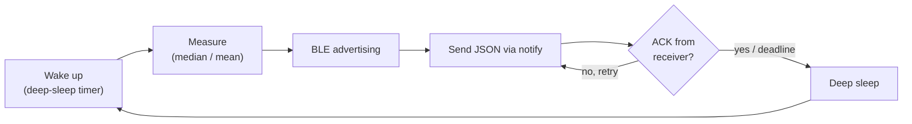

# BLE-TempSensor

Firmware for a battery-powered environmental sensor node based on an ESP32-C6
(Super Mini). At fixed intervals the node measures temperature, humidity and
optionally air pressure or illuminance, sends the values as JSON over BLE to a
receiver (e.g. an Ubuntu server) and then goes into deep sleep.

## How it works



- **BLE GATT server** (NimBLE): the node advertises, the receiver connects and
  subscribes to the notify characteristic.
- **Application-layer ACK**: the receiver confirms each message with the byte
  `0x06`. Without an ACK the node retries up to 5 times; a hard deadline (3 s)
  limits the awake time and thus the energy consumption.
- **Deep sleep**: default interval 600 s; the awake time is subtracted from the
  interval. Deep sleep can be disabled via a pin (GP20) for debugging.
- **Error status**: failed sensors are omitted from the JSON, an error bit field
  (`Error`) is always included.
- **Battery**: measured via ADC through a voltage divider, averaged; reported in
  mV and percent.

## Example payload

```json
{"Temperature":21.4,"Humidity":48,"Pressure":1012.3,"Battery":87,"Battery_mv":3980,"elapsed_ms":1250,"Version":"V1.3 (22.07.2026)","Error":"0x0000"}
```

## Hardware

- ESP32-C6 Super Mini
- One environmental sensor (selectable via define): BME280, SHT3x or HTU21
- Optional: BH1750 (illuminance), battery voltage divider on the ADC
- Pin assignment: [src/cpu/pinout.h](src/cpu/pinout.h)

## Configuration

All settings are in [src/settings.h](src/settings.h):

- Sensor variant (`SENSOR_00`, `SENSOR_01`) with device name, sensor type,
  TX power, battery divider ratio and log levels
- Sleep duration, ACK timeout, number of retries, send deadline

## Project structure

| Folder            | Content                                              |
| ----------------- | ---------------------------------------------------- |
| `src/main.cpp`    | Flow: measure, build JSON, send, deep sleep          |
| `src/ble/`        | BLE GATT server (NimBLE), notify and ACK             |
| `src/sensors/`    | Drivers for BME280, SHT3x, HTU21, BH1750, battery    |
| `src/cpu/`        | I²C driver, pinout, log colors                       |
| `src/services/`   | Logging (`gxLog`) and helper classes                 |

## Build

PlatformIO with the Arduino framework (pioarduino):

```
pio run -e ESP32-Linux --target upload
pio device monitor -e ESP32-Linux
```

On Windows use the `ESP32-C6-mini` environment (COM6).

## BLE interface

| Element          | UUID                                   |
| ---------------- | -------------------------------------- |
| Service          | `4fafc201-1fb5-459e-8fcc-c5c9c331914b` |
| Characteristic   | `beb5483e-36e1-4688-b7f5-ea07361b26a8` |

## RSSI quality

| RSSI   | Quality                |
| :----: | ---------------------- |
| -50 dB | excellent              |
| -60 dB | very good              |
| -70 dB | good                   |
| -80 dB | low                    |
| -90 dB | bad / no signal        |
